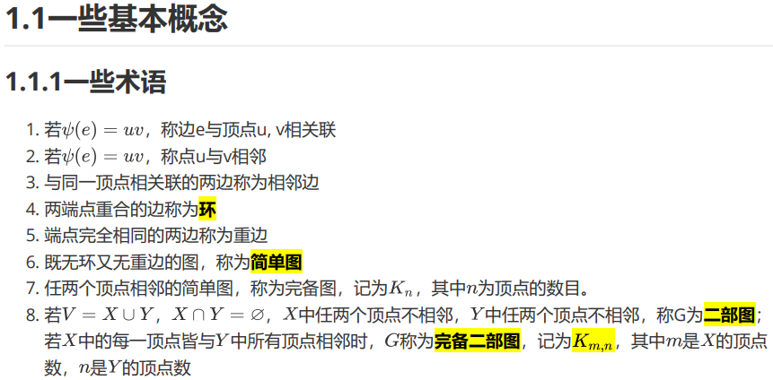
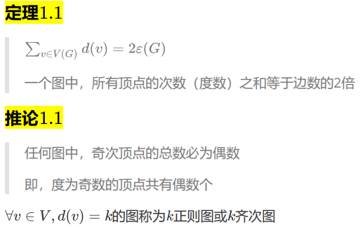
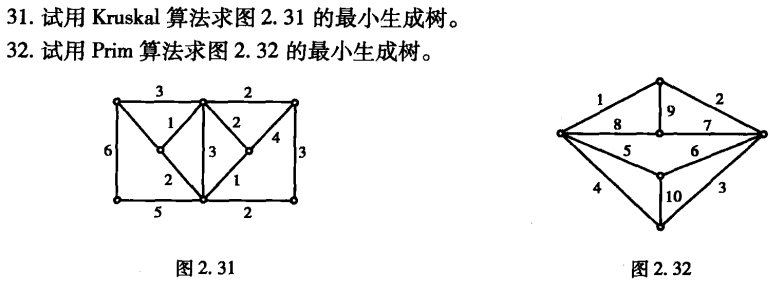

# 第一章

# 第二章

## 一、图的路与连通性

### **1. 定义**

#### **(1) 通路（Walk）**
一个有限非空序列  
**v₀ e₁ v₁ e₂ … eₖ vₖ** ，其中每条边 eᵢ 的端点为 vᵢ₋₁ 和 vᵢ。
- 边数称为通路长度。
- v₀、vₖ 为起点与终点。
- 中间顶点为内部点。
#### **(2) 道路（Trail）**
边不重复的通路称为道路（迹）。
#### **(3) 路径（Path）**
顶点不重复的通路称为路径。
#### **(4) 闭通路 / 回路（Cycle）**
起点与终点重合的通路/道路/路径分别称为闭通路、闭道路、圈。
- 长度为 k 的称 k-圈
- k 为奇数 → 奇圈
- k 为偶数 → 偶圈
#### **(5) 距离**
两顶点的距离 d(u,v)：u 与 v 之间最短路的长度；不可达则 d(u,v)=∞。
#### **(6) 连通性**
- 若两点 u、v 之间存在路径 → 连通
- 若任意两点连通 → 连通图
- 否则为非连通图
- 非连通图中极大连通子图称为连通分支
- 分支数为连通分支个数
#### **(7) 图的直径**
连通图 G 的直径为：所有顶点对距离的最大值。  
不连通图直径定义为 ∞.
### **2. 定理与推论**
#### **定理（存在圈）**
==若图 G 的最小度 δ ≥ 2，则 G 中必有圈。==
#### **定理：不连通图的补图必连通**
若图 G 不连通，则其补图 $\overline{G}$ 连通。
#### **偶图判定定理**
==**定理：一个图是偶图（即二分图）当且仅当它不包含奇圈。**==
## 二、树与森林
### **1. 定义**
#### **(1) 树**
不含圈的 **连通** 图称为树（无圈连通图）。
#### **(2) 森林**
无圈图（可以不连通）称为森林。森林的每个连通分支都是树。
- 树与森林都是二分图（偶图）。
### **2. 树的重要性质（定理）**
#### **定理 1：每棵非平凡树至少有两个树叶（度为 1 的点）**
（利用最长路径证明。）
#### **定理 2：图 G 是树当且仅当任意两点间存在唯一一条路**
- 唯一路 → 无圈
- 任意两点连通 → 连通图
#### **定理 3：n 阶树 T 的边数 m = n − 1**
并给出归纳证明。
##### **推论例：树叶数计算（例 7）**
若树有 12 条边，顶点度为 1、2、5，且恰有 3 个度为 2 的点 → 有 8 个树叶。
#### **定理 4：每个 n 阶连通图的边数至少为 n − 1**
且当 G 是树时等号成立。  
→ 树是最小连通图。
#### **定理 5：树中两个不邻接顶点加一条边会产生唯一圈**
#### **定理 6（树叶下界）**
若树 G 的最大度 Δ ≥ k，则 G 至少有 k 个树叶。
## 三、生成树（Spanning Tree）
### **1. 定义**
#### **(1) 生成树**
图 G 的一个生成子图 T 若是树，则称为 G 的一棵生成树。  
非生成树的边称为 **弦**。
#### **(2) 生成森林**
若生成子图为森林，则为 G 的生成森林。
### **2. 生成树的重要性质**
#### **定理 1：每个连通图至少包含一棵生成树**
（破圈法：不断去掉圈中一条边。）
#### **推论：若 G 是 (n,m) 连通图，则 m ≥ n − 1**
## 四、生成树计数
### **1. 定义：边收缩**
边 e 被收缩得到图 G⋅e：将 e 两端点合并。
### **2. Cayley 递推公式**
#### **定理（Cayley）：**
对任意边 e，有$\textcolor{red}{\tau(G)=\tau(G-e)+\tau(G\cdot e)}$
其中 τ(G) 表示 G 的生成树数目。
#### **3. 矩阵树定理（Kirchhoff）**
#### **定理（Matrix Tree Theorem）：**
设图 G 的拉普拉斯矩阵为 C，则  
**G 的生成树数 = C 删除任意一行一列后的代数余子式值。**
### **4. Cayley 公式（完全图的生成树数）**
#### **定理：完全图 Kn 的生成树棵数为**
$\textcolor{red}{\tau(K_n)=n^{n-2}}$  
## 五、最小生成树（MST）算法相关定理

### **克鲁斯克尔算法（Kruskal）**

#### **定理：克鲁斯克尔算法所得生成树必为最小生成树**
### **Prim 算法（Prim）**
Prim 算法的结果也是最小生成树（证明略）。
### **管梅谷破圈法**
不断从图中任意圈中删去最大权值边，直到无圈，得到最小生成树（证明略）。
## 作业

