# 第一章

定理1.1也是==握手定理==

# 第二章

## 一、图的路与连通性

### **1. 定义**

#### **(1) 通路（Walk）**
一个有限非空序列  
**$v₀ e₁ v₁ e₂ … eₖ vₖ$** ，其中每条边 $e$ᵢ 的端点为 $vᵢ₋₁$ $和$ $vᵢ$。
- 边数称为通路长度。
- $v₀$、$vₖ$ 为起点与终点。
- 中间顶点为内部点。
#### **(2) 道路（Trail）**
边不重复的通路称为道路（迹）。
#### **(3) 路径（Path）**
顶点不重复的通路称为路径。
#### **(4) 闭通路 / 回路（Cycle）**
起点与终点重合的通路/道路/路径分别称为闭通路、闭道路、圈。
- 长度为 k 的称 k-圈
- k 为奇数 → 奇圈
- k 为偶数 → 偶圈
#### **(5) 距离**
两顶点的距离 $d(u,v)$：u 与 v 之间最短路的长度；不可达则 $d(u,v)=∞$。
#### **(6) 连通性**
- 若两点 u、v 之间存在路径 → 连通
- 若任意两点连通 → 连通图
- 否则为非连通图
- 非连通图中极大连通子图称为连通分支
- 分支数为连通分支个数
#### **(7) 图的直径**
连通图 G 的直径为：所有顶点对距离的最大值。  
不连通图直径定义为 ∞.
### **2. 定理与推论**
#### **定理（存在圈）**
==若图 G 的最小度 $δ ≥ 2$，则 G 中必有圈。==
#### **定理：不连通图的补图必连通**
若图 G 不连通，则其补图 $\overline{G}$ 连通。
#### **偶图判定定理**
==**定理：一个图是偶图（即二分图）当且仅当它不包含奇圈。**==
## 二、树与森林
### **1. 定义**
#### **(1) 树**
不含圈的 **连通** 图称为树（无圈连通图）。
#### **(2) 森林**
无圈图（可以不连通）称为森林。森林的每个连通分支都是树。
- 树与森林都是二分图（偶图）。
### **2. 树的重要性质（定理）**
#### **定理 1：每棵非平凡树至少有两个树叶（度为 1 的点）**
（利用最长路径证明。）
#### **定理 2：图 G 是树当且仅当任意两点间存在唯一一条路**
- 唯一路 → 无圈
- 任意两点连通 → 连通图
#### **定理 3：n 阶树 T 的边数 m = n − 1**
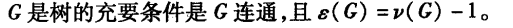
#### **定理 4：每个 n 阶连通图的边数至少为 n − 1**
且当 G 是树时等号成立。  
→ 树是最小连通图。
#### **定理 5：树中两个不邻接顶点加一条边会产生唯一圈**
#### **定理 6（树叶下界）**
若树 G 的最大度 $Δ ≥ k$，则 G 至少有 k 个树叶。
## 三、生成树（Spanning Tree）
### **1. 定义**
#### **(1) 生成树**
图 G 的一个生成子图 T 若是树，则称为 G 的一棵生成树。  
非生成树的边称为 **弦**。
#### **(2) 生成森林**
若生成子图为森林，则为 G 的生成森林。
### **2. 生成树的重要性质**
#### **定理 1：每个连通图至少包含一棵生成树**
（破圈法：不断去掉圈中一条边。）
#### **推论：若 G 是 (n,m) 连通图，则 m ≥ n − 1**
## 四、生成树计数
### **1. 定义：边收缩**
边 e 被收缩得到图 $G⋅e$：将 e 两端点合并。
### **2. Cayley 递推公式**
#### **定理（Cayley）：**
对任意边 e，有$\textcolor{red}{\tau(G)=\tau(G-e)+\tau(G\cdot e)}$
其中 τ(G) 表示 G 的生成树数目。
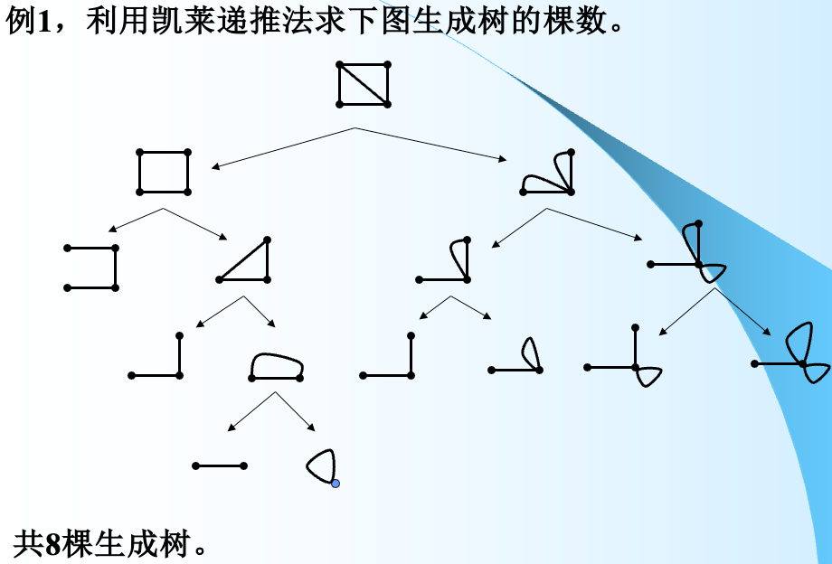
#### **3. 矩阵树定理（Kirchhoff）**
#### **定理（Matrix Tree Theorem）：**
设图 G 的拉普拉斯矩阵为 C，则  
**G 的生成树数 = C 删除任意一行一列后的代数余子式值。**
### **4. Cayley 公式（完全图的生成树数）**
#### **定理：完全图 Kn 的生成树棵数为**
$\textcolor{red}{\tau(K_n)=n^{n-2}}$  
## 五、最小生成树（MST）算法相关定理

**克鲁斯克尔算法（Kruskal）**
克鲁斯克尔算法所得生成树必为最小生成树
**Prim 算法（Prim）**
**管梅谷破圈法**
不断从图中任意圈中删去最大权值边，直到无圈，得到最小生成树（证明略）。
## 作业
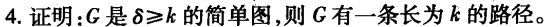

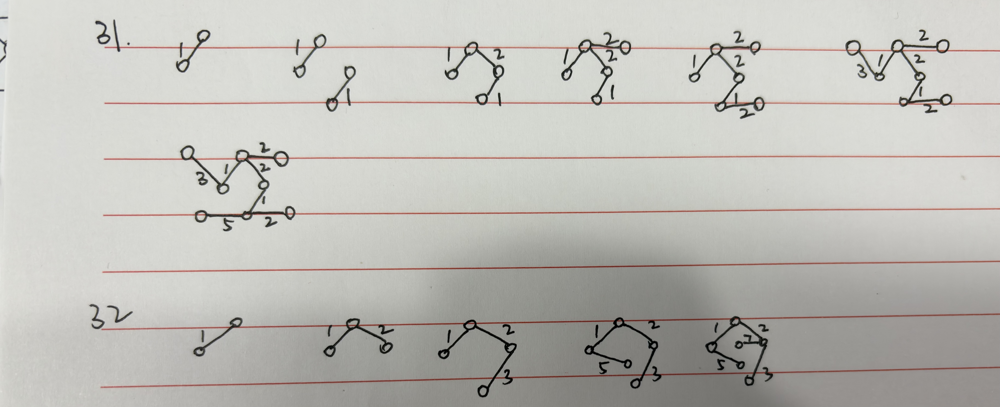
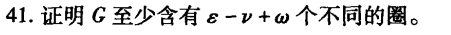

# 第三章

## **§3.1 割边、割点与块**

### **一、割边（Bridge / Cut Edge）**

### **定义1（割边）**

设 e 是图 G 的一条边，若  
$\omega(G-e)>\omega(G)$ 
即删边后连通分支数增加，则称 **e 为 G 的割边**。
**例：**
- 非平凡树的每条边都是割边。
#### **定理1（割边判定定理）**
==**e 是图 G 的割边 ⇔ e 不在 G 的任何圈中。**  ==
#### **推论（割边的充分条件）**
若 e 含在 G 的某个圈中，则删除 e 后图 **仍连通**。  
即：==**若 e 属于某个圈 → e 不是割边。**==
### **二、割点（Cut Vertex / Articulation Point）**
#### **定义2（割点）**
若图 $G = (V,E)$ 的顶点 v 满足：  
E 可分成两个非空子集 E₁、E₂，使得 $G[E₁]$与 $G[E₂]$ **恰有一个公共顶点 v**，  
则称 v 为 **G 的割点**。
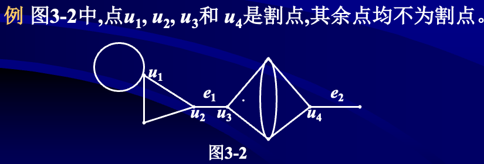
#### **性质与说明**
(1) 若$\omega(G-v)>\omega(G)$ 则 v 必为割点。
(2) 若 G 无环且非平凡，则：$v \text{ 是割点} \iff \omega(G-v)>\omega(G)$
(3) 无环连通图中：删点后图不连通的点即为割点。
#### **定理2（树中割点判定）**
设 v 是树的顶点，则：$v \text{ 是割点} \iff d(v)>1$
即树中度大于 1 的点为割点。
#### **定理3（割点的路径刻画）**
设 v 是无环连通图 G 的顶点，则以下等价：
- v 是 G 的割点
- 存在 $G-v$ 的两个非空顶点集 V₁、V₂，使得  
    对任意 $x∈V₁$、$y∈V₂$，**v 在每一条 (x,y) 路上**。
## **§3.2 连通度（Vertex-Connectivity）**
### **一、顶点割与连通度**

#### **定义1（顶点割）**
若顶点集 $V′ ⊆ V(G)$ 满足  
$G−V′$ 不连通，则称 V′ 为 **G 的顶点割**。  
含 k 个顶点的称为 **k-顶点割**。
最小顶点割的大小 = **图的连通度 κ(G)**（若图连通且存在割点）。
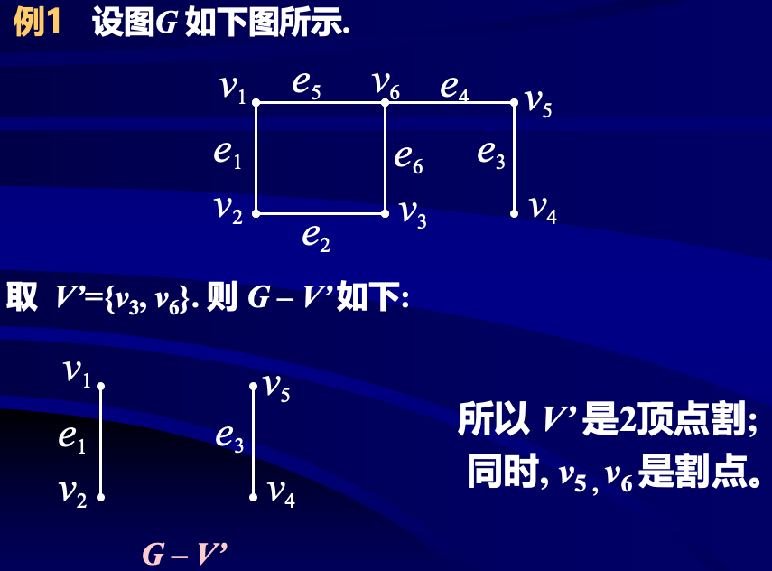
#### **定义2（连通度 κ(G)）**
对 n 阶连通图 G：
- 若 G 有顶点割，则最小顶点割的点数为 κ(G)；
- 若 G 无顶点割（如完全图），则 $\kappa(G)=n-1$
- 若 G 非连通，则 κ(G)=0。
#### **例**
- κ(Kₙ) = n−1
- κ(Cₙ) = 2（其中Cn为n圈，n ≥ 2）

### **二、边割与边连通度**
#### **定义3（边割、边连通度）**
(1) 边集 E′ 使 G−E′ 不连通，则 E′ 为 **边割**，含 k 条边称 **k-边割**。  
(2) 最小边割的大小为 **边连通度 λ(G)**。
- 非连通图或平凡图：λ(G)=0。
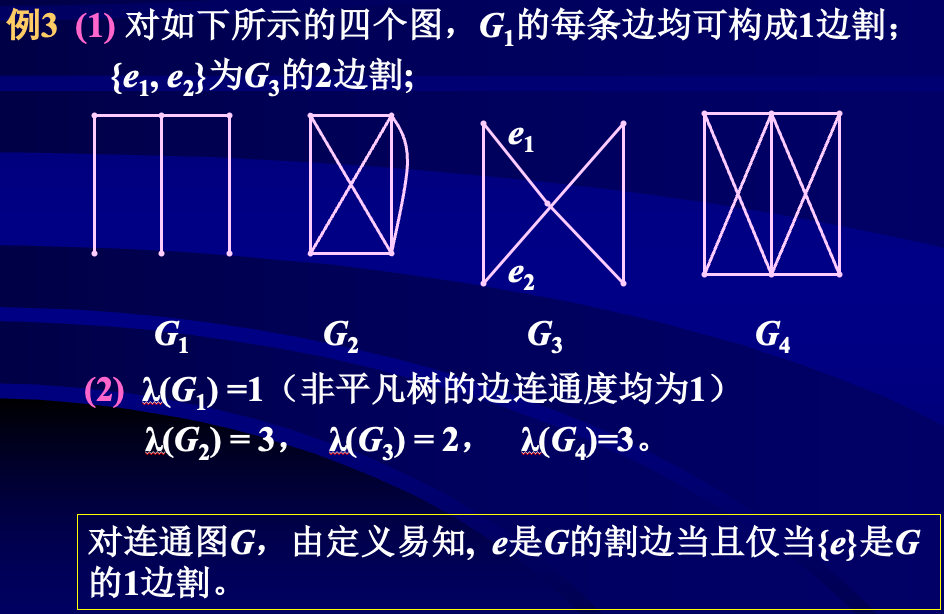
#### **性质**
- e 是割边 ⇔ {e} 是 1-边割。
- 非平凡树 λ(G)=1。
## **三、边连通度与点连通度、最小度的关系**

#### **定理6（重要不等式）**

对任意图 G，都有：$\textcolor{red}{κ(G)  ≤  λ(G)  ≤  δ(G)}$
其中：
- κ(G) = 连通度（最小点割）
- λ(G) = 边连通度（最小边割）
- δ(G) = 最小度
#### **意义：**
- 一个图要被“点破坏”比“边破坏”更容易。
- 图的“最薄弱之处”由最小度决定。
### **定理6 证明主要逻辑（总结版）**

1. δ(G) 是任一顶点的度，因此其关联所有边构成一个边割 → λ(G) ≤ δ(G)
2. 用归纳法证明 κ(G) ≤ λ(G)：
    - 若 λ(G)=1，则图有割边 → κ(G)=1
    - 若 λ(G)=k≥2，用删除 k 条边使图断开，然后构造点割证明 κ(G) ≤ k
## **四、关于边连通度的上界（定理7）**
### ==**定理7**==
设 G 是一个 n 阶、m 条边的连通图，则：
$κ(G) \le \frac{2m}{n}​$
由于：
$δ(G)\le \frac{2m}{n}​$
由定理6 结合 δ≥κ 得：
$κ(G)\le \left\lfloor \frac{2m}{n} \right\rfloor$
## 作业

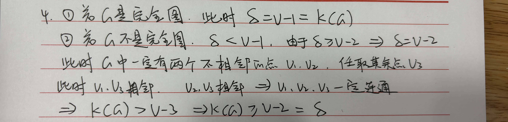

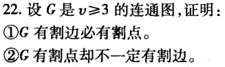
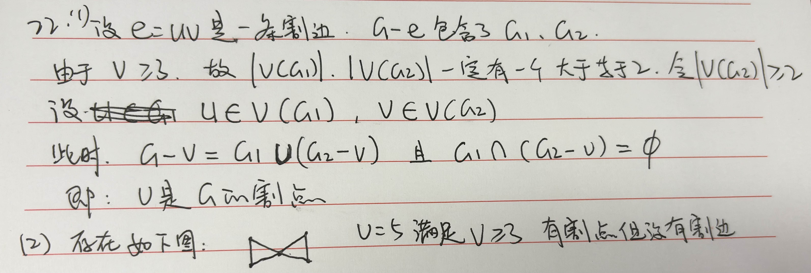
# 第四章
 Dijkstra和Floyd，学计算机的都会，略
 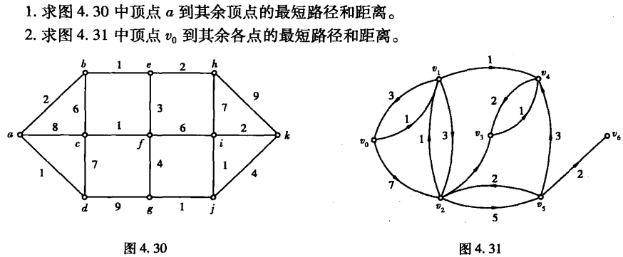
 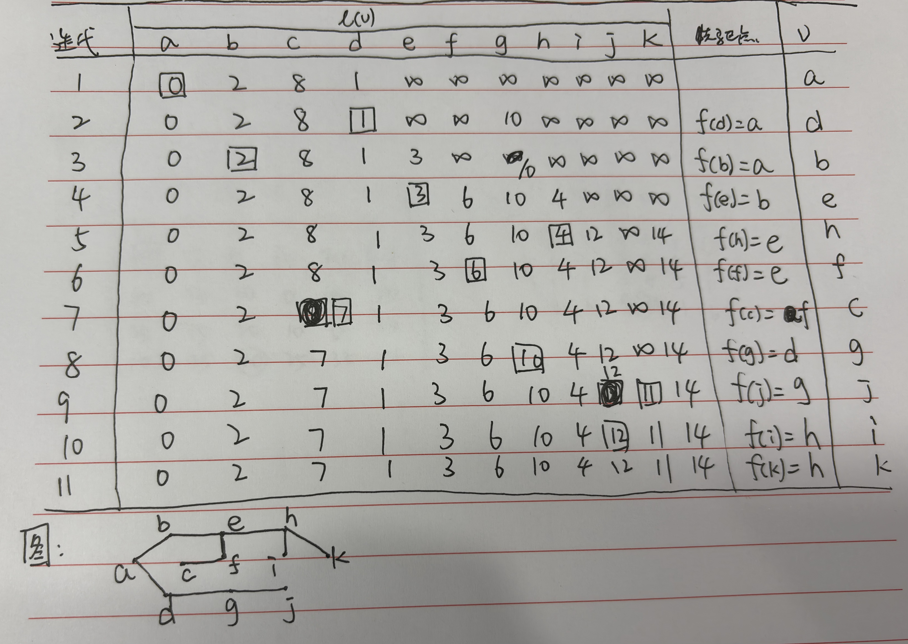
 
 
 
 
# 第五章(1)
## **一、图的匹配与贝尔热定理**

### **1. 匹配相关概念**
#### **定义1：匹配（Matching）**
若边集 **$M ⊆ E(G)$** 中任意两条边 **没有公共端点**，则称 M 为 G 的匹配。  
（也称对集或边独立集）  
顶点若被 M 中某条边饱和，则称为 **M-饱和点**；否则为 **M-非饱和点**。  
#### **定义2：最大匹配（Maximum Matching）**
若 M 是包含边数最多的匹配，则称 M 为 **最大匹配**。
若最大匹配使 G 的所有顶点均被饱和，则称为 **完美匹配（Perfect Matching / Ideal Matching）**。 
（图可能不存在完美匹配）  
#### **定义3：M-交错路（Alternating Path）**
若一条路的边依次 **在 M 与不在 M 中交替出现**，则称为 M-交错路。
**若交错路两端点均为 M-非饱和点，则称这条路为 M-可扩路（augmenting path）。**  
### **2. 贝尔热定理（Matching 的核心定理）**
#### **定理1（贝尔热定理，Berge 1957）**
匹配 M 是最大匹配 **当且仅当**：  
$\text{G 中不存在 M 可扩路}$
#### **证明关键点（总结）**
- 若存在 M 可扩路 P，则可令：  
    $M' = M \Delta E(P)$
    得到边数更多的匹配，与 M 最大性矛盾。
- 反之，若 |M₁|>|M|，则 M₁ΔM 可分解为若干：
    - M₁/M 交替偶圈
    - 至少一条 M 可扩路  
        因此与“不存在可扩路”矛盾。

## **二、偶图的匹配与覆盖**
### **1. 偶图匹配存在性判定 —— Hall 定理**
#### **定理2（Hall 定理 / 婚姻定理）**
对偶图 (G=(X,Y))，存在饱和 **X 所有顶点** 的匹配 **当且仅当**  
$\forall S\subseteq X,\quad |N(S)|\ge |S|$
（N(S) 为 S 的邻接顶点集）  
#### **推论（Hall 定理的另一表述）**
若存在某个 S⊆X，使：
$|N(S)| < |S|$
则 **不存在** 从 X 到 Y 的匹配。  
#### **婚姻定理（Hall 定理的口语表述）**
“要使 r 个女人能各自与她们认识的男人结婚，必要且充分条件是：任意 k 个女人至少共同认识 k 个男人。”  
#### **推论：k-正则偶图一定存在完美匹配**
若 G 是 k (>0) 正则偶图，则 G 存在完美匹配。
理由：
- $k|X| = k|Y| ⇒ |X|=|Y|$
- 对任何 S⊆X：
    $k∣S∣=∣E(S,N(S))∣≤k∣N(S)∣⇒∣N(S)∣≥∣S∣$    
    合乎 Hall 条件。
#### **树至多存在一个完美匹配**（重要性质）
##### **命题 / 例3**

树中若存在两个不同的完美匹配 (M_1, M_2)，则  
$T[M_1 \Delta M_2]$ 
包含圈，与“树无圈”矛盾。
因此：
> **树的完美匹配至多只有一个。**
## **三、覆盖（Vertex Cover）与哥尼定理**

### **1. 点覆盖（Vertex Cover）**
#### **定义4：点覆盖（Vertex Cover）**
若顶点集 K ⊆ V(G) 使得 **每条边至少有一个端点在 K 中**，  
则称 K 为点覆盖。
点数最少的点覆盖称为 **最小点覆盖**，记作 $α(G)$。  
#### **定理3（匹配与覆盖之间的关系）**
若 M 是 G 的匹配、K 是 G 的点覆盖，且：
$|M| = |K|$
则
- M 是最大匹配
- K 是最小覆盖  
### **2. 哥尼定理（Kőnig's Theorem）**
#### **定理4（哥尼定理，1931）**
在 **偶图** 中  
$\text{最大匹配的边数} = \text{最小点覆盖的顶点数}$
（Matching number = Cover number）  
这是二分图的核心结构性质，构成最大匹配算法的理论基础。
## **四、托特（Tutte）定理与彼得森定理**
### **1. 托特定理（Tutte 1947）**
#### **定理5（托特定理）**
图 G 有完美匹配 当且仅当 对任意非空真子集 S ⊂ V(G)：
$o(G-S) \le |S|$
其中 $o(G-S)$ 表示 **G-S 中奇分支（奇连通分支）数量**。  
这是判断任意图是否有完美匹配的最重要判定定理。
### **2. 彼得森定理（推论）**
#### **推论（彼得森定理）**
若图 G 是：
- **3-正则图**
- **无割边**
则 G 存在完美匹配。 
## **五、总结**
### **定义（7 个）**
1. 匹配 Matching
2. 最大匹配、完美匹配
3. M-交错路、M-可扩路
4. 点覆盖定义
5. 覆盖数 α(G)
6. 奇分支数 o(G-S)（在托特定理中使用）
### **定理（6 个）**
1. **贝尔热定理**（最大匹配 ⇔ 无可扩路） 
2. **Hall 定理**（偶图饱和 X 顶点的匹配存在性）
3. 匹配与覆盖大小关系定理（|M|=|K|）
4. **哥尼定理**（二分图最大匹配 = 最小点覆盖
5. **托特定理**（完美匹配判定
6. **彼得森定理**（3-正则无割边 ⇒ 完美匹配）
### **重要推论（3 个）**
1. 若存在 S⊆X 使 $|N(S)|<|S|$ ⇒ 偶图无匹配
2. k-正则偶图一定存在完美匹配
3. 树至多存在一个完美匹配
# 第五章(2)
## 一、匹配与交错树（用于匈牙利算法）
### **定义1：M-交错树（Alternating Tree）**
设 **G = (X, Y)** 为二分图，M 为 G 中的匹配，u 为 M 的非饱和点。  
称树 **H** 为 **扎根于 u 的 M-交错树**，若满足：
1. $u \in V(H)$
2. 对任意 $v \in V(H)$，从 u 到 v 的路径是 **M-交错路**  
    （即边在 M 与不在 M 中交替出现）
### **定义：M-可扩路（Augmenting Path）**
在二分图中：
**一条从 M 非饱和点出发、到另一非饱和点结束、且是交错路径的路 P 称为 M-可扩路。**
利用可扩路 P，可以更新匹配：
$M' = M \Delta E(P)$
使匹配规模增大 1。  
（匈牙利算法的核心思想）
## 二、匈牙利算法（用于求完美匹配）
### **算法基于的关键理论（Hall 定理隐含）**
#### **推论（来自交错树分析）**
若在 M-交错树中：
$N(S) = T$
其中
- $S = V(H) \cap X$
- $T = V(H) \cap Y$
即 “邻接集与分层一致”
则由 **Hall 定理** 得：
$|N(S)| < |S| \quad\Rightarrow\quad G\text{ 无完美匹配}$
（匈牙利算法中用于判断“不存在完美匹配”）
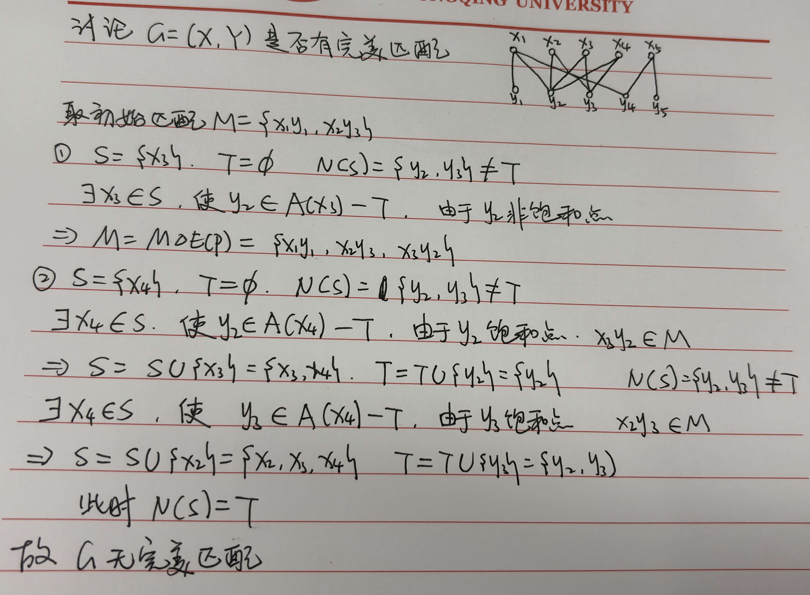
## 三、最大匹配算法（匈牙利算法扩展）
匈牙利算法最初用于 **完美匹配**。  
通过继续在所有 M 非饱和点上构建交错树，可扩展为 **最大匹配算法**。
## 四、最优匹配（Assignment Problem）
用于求 **加权二分图** 的最大权完美匹配（匈牙利算法的加权版：Kuhn–Munkres / Hungarian algorithm）。
### **定义2：可行顶点标号（Feasible Labeling）**
设 $G = (X, Y)$ 为加权完全二分图，边权为 $w(x, y)$。  
若顶点标号函数：
$l : X \cup Y \to \mathbb{R}$
满足对于任意 $x \in X, y \in Y$：
$l(x) + l(y) \ge w(x,y)$
则称 $l$ **是一个可行顶点标号**。
#### **推论：可行标号总是存在**
任意加权完全二分图，都能构造可行标号，例如：
$l(x_i) = \max_{y_j} w(x_i, y_j), \quad l(y_j) = 0$
### **定义3：相等子图（Equality Graph）**
给定可行顶点标号 l，则定义：
$E_l = {(x,y) \mid l(x)+l(y)=w(x,y)}$
以 $E_l$ 为边集的生成子图：
$G_l = (X, Y; E_l)$
称为 **相等子图**（Equality graph）。
### **定理：相等子图中完美匹配 = 最优匹配**（核心定理）
#### **定理**
若可行标号 $l$ 的相等子图 $G_l$ 中存在完美匹配 $M^*$  
则 $M^*$ 是原图 G 的 **最优匹配**。
#### **证明要点总结**
对相等子图的完美匹配：$w(M^*) = \sum_{(x,y)\in M^*} w(x,y)= \sum_{(x,y)\in M^*} (l(x)+l(y))$，任意其他完美匹配 M，由可行标号条件：
$w(x,y) \le l(x)+l(y)$，
因此：$w(M) \le w(M^*)$。
从而：
$M^* \text{ 为最优匹配}$，
==这是加权匈牙利算法正确性的核心。==
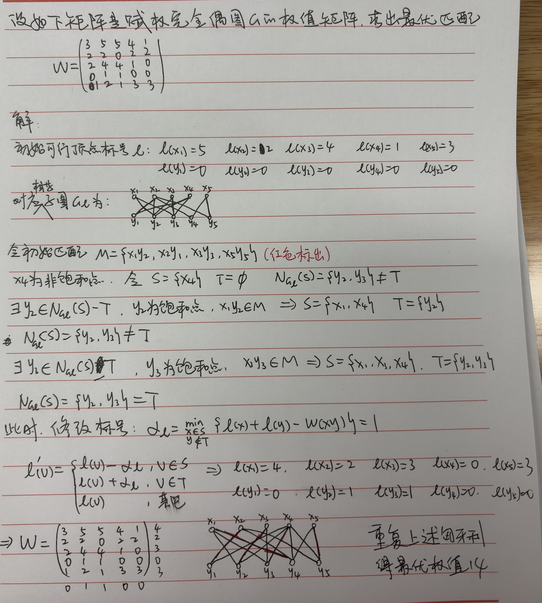
## 五、总结（定义 · 定理 · 推论总览）
### **定义**
1. **M-交错树**
2. **M-可扩路**
3. **可行顶点标号**
4. **相等子图**
### **定理**
1. **交错树中若 (N(S)=T) 则无完美匹配**（Hall 推论）
2. **相等子图有完美匹配 ⇒ 该匹配为最优匹配**（核心定理）
### **推论**
1. 任意加权完全二分图都存在可行顶点标号。
2. 相等子图寻找完美匹配即可求得最优匹配。
## 作业
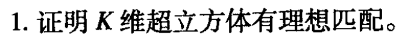
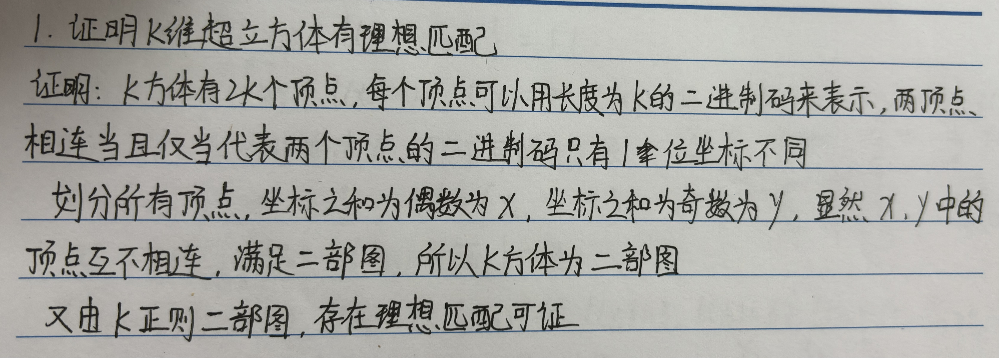
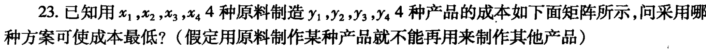
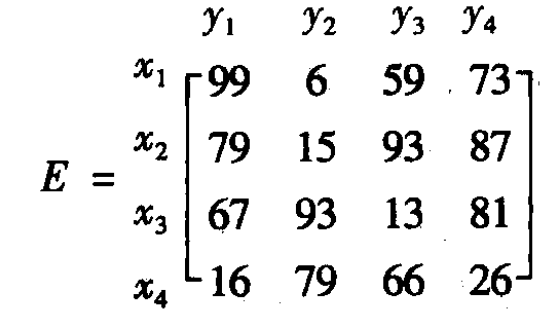
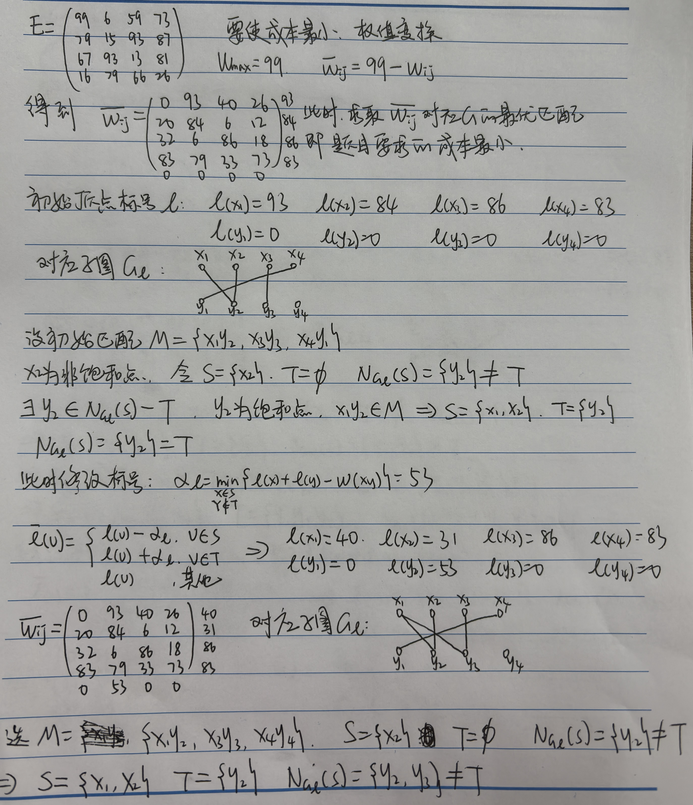

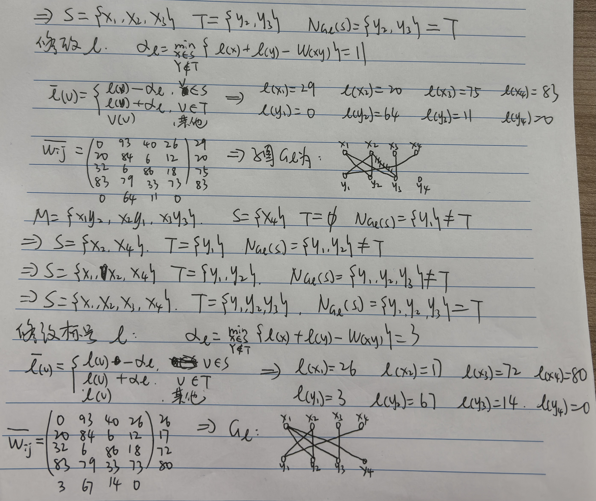

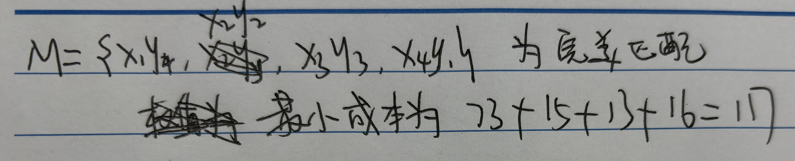
# 第六章(1)
## 一、欧拉图及其性质
### **1. 定义：欧拉图（Eulerian Graph）**
#### **定义 1（欧拉图）**
若连通图 $G$ 中存在 **经过每条边一次且仅一次的闭道路**，  
则称 $G$为 **欧拉图（Eulerian graph）**，也称 $E$ 图。
该闭道路称为：
- 欧拉闭道路
- 欧拉回路
- 欧拉环游  
### **2. 欧拉图的性质（核心定理）**
#### **定理 1（欧拉图判定定理）**
对非平凡连通图 $G$，以下三种表述等价：
1. $G$ 是欧拉图
2. $G$ 的所有顶点都是 **偶度** （==和握手定理不一样==）
3. $E(G)$ 可划分为若干个圈（cycle partition）  
#### **推论 1**
连通图 (G) 是欧拉图 **当且仅当** 所有顶点度数为偶数。  
#### **推论 2**
连通非欧拉图 (G)，存在欧拉道路（起点 ≠ 终点的欧拉路） **当且仅当**  
图中 **恰有两个顶点为奇度**。  
## 二、 Fleury 算法（求欧拉回路的方法）
### **1. 定义（Fleury 算法）**
用于从欧拉图中 **求一条欧拉环游**。
#### **算法步骤：**
1. 任取顶点 $v_0$，设 $w_0 = v_0$。
2. 已取路径 $v_0 e_1 v_1 \cdots v_i$ 后，从剩余边中选下一条边 $e_{i+1}$，满足：
    - 与当前顶点 (v_i) 相连
    - **不是割边（除非没有其他边可选）**
3. 不能继续时算法结束，得到一条欧拉环游。 
## 三、 Hierholzer 算法（更高效的求欧拉回路算法）
### **定义（Hierholzer 算法）**
用于在欧拉图（无向、有向均可）中快速求欧拉巡回
#### 步骤：
1. 任取顶点 $v_0$，从它出发走一条闭道路 $T_0$。
2. 若 $T_i$上存在未遍历边的顶点 $v_i$，  
    则从 $v_i$ 出发在剩余图中构造新的闭道路 $T'$，  
    并 **插入** $T_i$ 中生成更长环游 $T_{i+1}=T_i∪T'$。
3. 重复直到所有边都被包含。  
## 四、中国邮路问题（Chinese Postman Problem, CPP）
### **1. 问题定义**
给定一个 **边赋权连通图**（街道长度），  
从邮局出发，需要 **至少一次经过每条边**，最后回到邮局。  
希望总路程最小。  
### **2. 基本结论（管梅谷 1962）**
#### **定理 2（管梅谷定理）**
设 $W$ 是 $G$ 中一条包含所有边的闭通路。  
则 $W$ 为最短的（最优的）当且仅当：
1. **每条边最多重复一次**；
2. 在 $G$ 的每个圈上，重复的边条数 **不超过圈长的一半**。  
### **3. 一般赋权图的最优欧拉环游步骤（基于定理 2）**
对于任意非负权图 (G)，求最优邮路：
#### (1) 添加重复边得到欧拉母图 $G^*$
要求 $G^*$所有顶点度为偶。
#### (2) 在 $G^*$ 中用 Fleury 算法求欧拉环游
该环游即为原图的最优邮路。  
## 五、特殊情况：仅有两个奇顶点

### **定理（两个奇顶点最优欧拉环游）**
若图 $G$ 有且仅有两个奇顶点 $u$ 和 $v$，  
则最优欧拉环游算法为：
1. 在 $G$ 中求出 $u,v$ 的最短路径 $P$。
2. 在路径 $P$ 上 **添加重复边**，得到欧拉图 $G^*$。
3. 在 $G^*$ 中求欧拉环游。  
#### **定理（正确性）**
按上述方法得到的欧拉环游即为最优欧拉环游。  
## 六、一般情况：有 2n 个奇顶点
### **Edmonds 算法（1965）**
用于一般图（奇顶点数为偶数 ≥4）的最优邮路问题。
#### 步骤：
1. 用 Floyd 算法求出各奇度顶点间的最短路及距离。
2. 构造一个 **奇顶点完备图 $G_1$**，边权为原图中对应顶点之间的最短路长度。
3. 在 $G_1$ 中求 **最小权完美匹配**（Edmonds 算法）。
4. 在原图中沿匹配对连接路径 **添加重复边** 得欧拉图 $G^*$。
5. 在 $G^*$ 中求欧拉巡回（Fleury 算法）。  
结果即为原图的 **最优邮路**。
## 总结
### **定义类**
1. **欧拉图**（存在欧拉回路）
2. **欧拉闭道路 / 欧拉环游**
3. **Fleury 算法**
4. **Hierholzer 算法**
5. **中国邮路问题 CPP**
6. **欧拉母图 $G^*$**
7. **Edmonds 最小对集算法**
### **定理类**
1. **欧拉图三等价条件（定理 1）**
    - 是欧拉图
    - 所有顶点偶度
    - 边可以划分为圈
2. **管梅谷定理（定理 2）** 
    - 重边 ≤1
    - 每个圈重复边 ≤ 1/2 圈长
3. **两个奇顶点最优邮路定理**
4. **Edmonds 最优邮路算法正确性定理**
### **推论类**
1. **推论 1**：顶点全偶 ⇔ 欧拉图
2. **推论 2**：恰有两个奇度顶点 ⇔ 存在欧拉道路（开链）
# 第六章(2)
## 一、哈密尔顿图的基本概念
### **定义 1：哈密尔顿图（Hamiltonian Graph, H 图）**
若图 (G) 中存在：
- 一个经过 **所有顶点恰好一次**
- 并且能 **回到起点** 的闭途径（圈）
则称 $G$ 为 **哈密尔顿图**（H 图）。
该闭途径称为：
- **哈密尔顿圈（Hamiltonian cycle）**
- **生成圈（spanning cycle）**  
### **定义 2：哈密尔顿路（Hamiltonian Path, H 路）**
若图 (G) 中存在：
- 一条经过每个顶点恰好一次的 **路径**（但不要求回到起点）
则称为哈密尔顿路。  
## 二、哈密尔顿图的必要条件
### **定理 1（必要条件）**
若图 $G$ 为哈密尔顿图，则：
对 $V(G)$ 的任意非空顶点子集 $S$，都有：
$\omega(G - S) \le |S|$
即：删除任意非空顶点集 S 后，剩余图的连通分支数 **不超过 S 的大小**。
（这称为哈密尔顿图的 **连接性必要条件**）  
#### **含义：**
- 若删除 S 会使图断裂成比 |S| 多的分支  
    → 起码不能用一个圈把所有顶点连上 → 必非哈密尔顿图。
#### **推论（必要性）**
> 若存在某个 S，使 $> \omega(G-S) > |S|$
> 则 G **不是** 哈密尔顿图。
（但反之不成立：满足条件不能保证一定是 H 图）
### **例：彼得森图（Petersen graph）**
- 满足定理 1 的不等式
- 但 **不是** 哈密尔顿图（著名反例）  
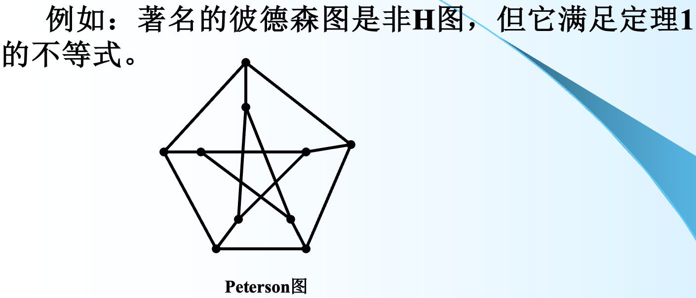
## 三、哈密尔顿图的充分条件（经典判定定理）
#### 🌟 注意：哈密尔顿图判定是 **NP-困难**，
这些定理是“强充分条件”，但不是必要条件。
#### **定理 2（Dirac 定理，1952）**
对 $n\ge 3$ 的简单图 (G)，如果：
$\delta(G) \ge \frac{n}{2}$
则 G 是哈密尔顿图。  
#### 含义：
- 若每个顶点的度都足够大（至少半图大小），  
    则必含哈密尔顿圈
### **定理 3（Ore 定理，1960）**

对 $n\ge 3$ 的简单图 G，若对于任意两个 **不相邻顶点** u、v：
$\deg(u) + \deg(v) \ge n$
则 G 是哈密尔顿图。  
### 含义：
- 弱化 Dirac 条件：要求的是“度和”，不是各自的度。
### 【注】Ore 定理的紧条件（PPT 中说明）
给出如下构造图：
- 将两个 $K_{k+1}$ 的顶点合并一个顶点
- 对此图，任意不相邻点度和满足 Ore 条件
- 但图 **不是** 哈密尔顿图
说明条件不可再弱化。  
## 四、哈密尔顿图研究的深入成果（非初等内容）
PPT 中介绍的历史进展（均为更强的充分条件，非必知）：
1. **闭包定理（Bondy-Chvátal Closure）**（1976）  
    强化 Ore 定理，闭包图与原图哈密尔顿性相同。
2. **Nicos（1985）的弱化 Ore 条件的改进**
3. **Chen、Egawa、Saito（1996）的进一步推进**
4. **赖虹建（2007）统一上述全部结果**
5. **范更华定理（中国 2005 国家自然科学二等奖）**
    > 若对任意距离为 2 的顶点对 (u,v)，  
    > 至少有一顶点度数 ≥ n/2，  
    > 则图存在哈密尔顿圈。
这些属于现代图论前沿成果。
## 五、推销员问题（TSP）与哈密尔顿图的关系
### **定义：最佳哈密尔顿圈（Optimal Hamiltonian Cycle）**
在加权图中，权值最小的哈密尔顿圈称为最佳 H 圈。  
### **定义：最佳推销员回路（Best Traveling Salesman Tour）**
在加权图 G 中：
- 经过每个顶点至少一次
- 回到起点
- 权值最小
的闭路称为最佳推销员回路。
（TSP = 在完备图中求最小权哈密尔顿圈）  
### **定理 1（TSP 条件）**
若对任意不同顶点 x,y,z：
$w(x,y) \le w(x,z) + w(z,y)$
则 G 的最佳 H 圈就是其最佳推销员回路。  
（即三角不等式成立时，两者等价）
### **定理 2（最短路闭包 TSP）**
加权图 G 的最佳推销员回路的权  
= 完备图 $G'$ 的最佳 H 圈的权。
其中 $G'$ 的边权定义为：
$w(x,y) = \min d_G(x,y)$
即：x 到 y 的最短路径权。  
## 六、TSP 近似算法（非“定义/定理/推论”，但 PPT 相关）
主要包括：
- 构造型方法
    
- 改进型方法（2-opt, 3-opt）
    
- 动态规划
    
- 神经网络方法
    
- 最小权匹配方法等  
    

其中 PPT 讲解了 **二边逐次修正法（2-opt）** 作为示例。

---

## 总结
###  **定义（5 个）**
1. 哈密尔顿图（生成圈）
2. 哈密尔顿路
3. 最佳 H 圈（最小权哈密尔顿圈）
4. 最佳推销员回路（TSP 回路）
5. 完备图最短距离闭包 (G')
###  **定理（8 个）**
1. 哈密尔顿图必要条件（连通分支不等式）
2. Dirac 定理（度 ≥ n/2）
3. Ore 定理（度和 ≥ n）
###  **推论（1 个）**
- **必要条件推论**：若 $∃ S$，使  
    $\omega(G-S) > |S|$
    ⇒ G 不是哈密尔顿图。
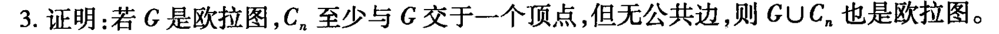
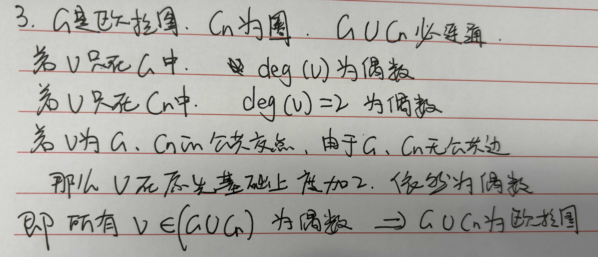
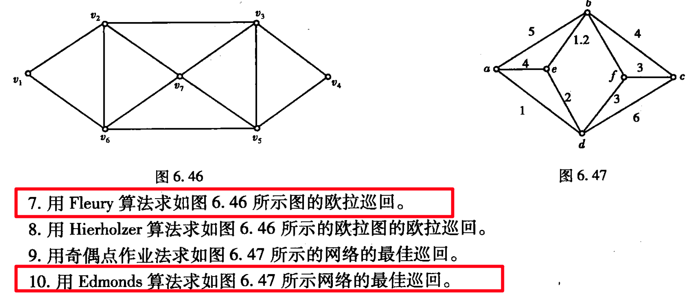
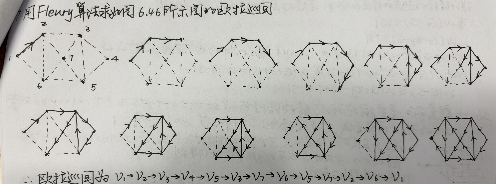
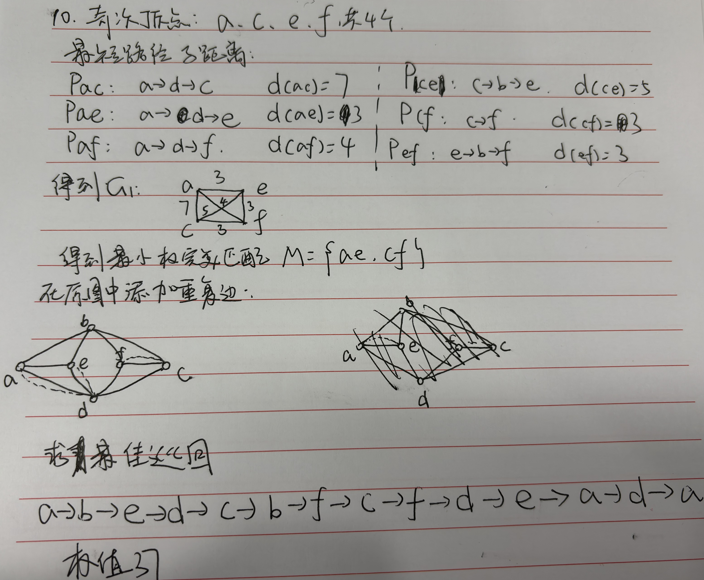