# 第一章

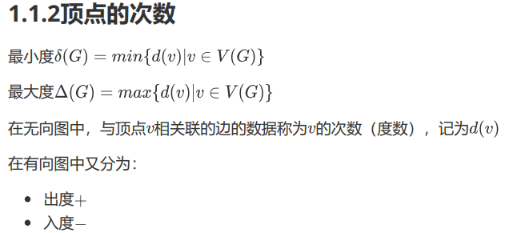

定理1.1也是==握手定理==

# 第二章

## 一、图的路与连通性

### **1. 定义**

#### **(1) 通路（Walk）**
一个有限非空序列  
**$v₀ e₁ v₁ e₂ … eₖ vₖ$** ，其中每条边 $e$ᵢ 的端点为 $vᵢ₋₁$ $和$ $vᵢ$。
- 边数称为通路长度。
- $v₀$、$vₖ$ 为起点与终点。
- 中间顶点为内部点。
#### **(2) 道路（Trail）**
边不重复的通路称为道路（迹）。
#### **(3) 路径（Path）**
顶点不重复的通路称为路径。
#### **(4) 闭通路 / 回路（Cycle）**
起点与终点重合的通路/道路/路径分别称为闭通路、闭道路、圈。
- 长度为 k 的称 k-圈
- k 为奇数 → 奇圈
- k 为偶数 → 偶圈
#### **(5) 距离**
两顶点的距离 $d(u,v)$：u 与 v 之间最短路的长度；不可达则 $d(u,v)=∞$。
#### **(6) 连通性**
- 若两点 u、v 之间存在路径 → 连通
- 若任意两点连通 → 连通图
- 否则为非连通图
- 非连通图中极大连通子图称为连通分支
- 分支数为连通分支个数
#### **(7) 图的直径**
连通图 G 的直径为：所有顶点对距离的最大值。  
不连通图直径定义为 ∞.
### **2. 定理与推论**
#### **定理（存在圈）**
==若图 G 的最小度 $δ ≥ 2$，则 G 中必有圈。==
#### **定理：不连通图的补图必连通**
若图 G 不连通，则其补图 $\overline{G}$ 连通。
#### **偶图判定定理**
==**定理：一个图是偶图（即二分图）当且仅当它不包含奇圈。**==
## 二、树与森林
### **1. 定义**
#### **(1) 树**
不含圈的 **连通** 图称为树（无圈连通图）。
#### **(2) 森林**
无圈图（可以不连通）称为森林。森林的每个连通分支都是树。
- 树与森林都是二分图（偶图）。
### **2. 树的重要性质（定理）**
#### **定理 1：每棵非平凡树至少有两个树叶（度为 1 的点）**
（利用最长路径证明。）
#### **定理 2：图 G 是树当且仅当任意两点间存在唯一一条路**
- 唯一路 → 无圈
- 任意两点连通 → 连通图
#### **定理 3：n 阶树 T 的边数 m = n − 1**

#### **定理 4：每个 n 阶连通图的边数至少为 n − 1**
且当 G 是树时等号成立。  
→ 树是最小连通图。
#### **定理 5：树中两个不邻接顶点加一条边会产生唯一圈**
#### **定理 6（树叶下界）**
若树 G 的最大度 $Δ ≥ k$，则 G 至少有 k 个树叶。
## 三、生成树（Spanning Tree）
### **1. 定义**
#### **(1) 生成树**
图 G 的一个生成子图 T 若是树，则称为 G 的一棵生成树。  
非生成树的边称为 **弦**。
#### **(2) 生成森林**
若生成子图为森林，则为 G 的生成森林。
### **2. 生成树的重要性质**
#### **定理 1：每个连通图至少包含一棵生成树**
（破圈法：不断去掉圈中一条边。）
#### **推论：若 G 是 (n,m) 连通图，则 m ≥ n − 1**
## 四、生成树计数
### **1. 定义：边收缩**
边 e 被收缩得到图 $G⋅e$：将 e 两端点合并。
### **2. Cayley 递推公式**
#### **定理（Cayley）：**
对任意边 e，有$\textcolor{red}{\tau(G)=\tau(G-e)+\tau(G\cdot e)}$
其中 τ(G) 表示 G 的生成树数目。

#### **3. 矩阵树定理（Kirchhoff）**
#### **定理（Matrix Tree Theorem）：**
设图 G 的拉普拉斯矩阵为 C，则  
**G 的生成树数 = C 删除任意一行一列后的代数余子式值。**
### **4. Cayley 公式（完全图的生成树数）**
#### **定理：完全图 Kn 的生成树棵数为**
$\textcolor{red}{\tau(K_n)=n^{n-2}}$  
## 五、最小生成树（MST）算法相关定理

**克鲁斯克尔算法（Kruskal）**
克鲁斯克尔算法所得生成树必为最小生成树
**Prim 算法（Prim）**
**管梅谷破圈法**
不断从图中任意圈中删去最大权值边，直到无圈，得到最小生成树（证明略）。
## 作业

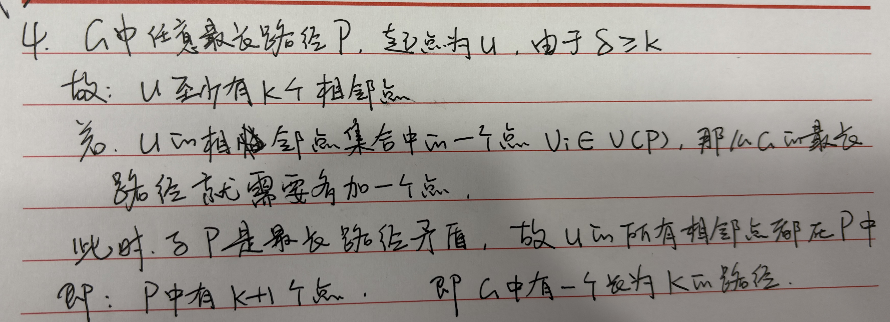
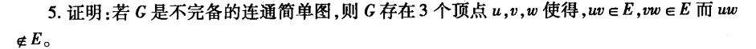
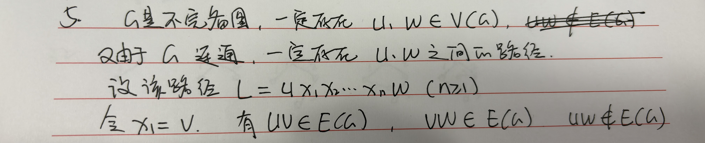
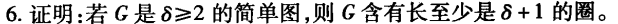
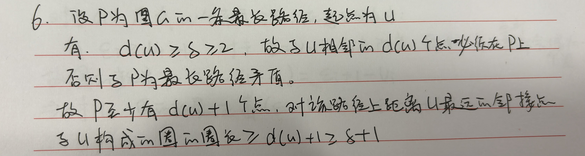

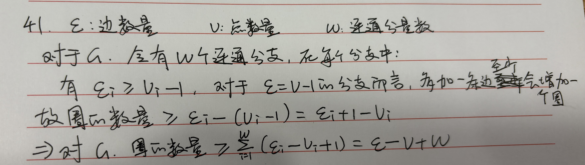

# 第三章

## **§3.1 割边、割点与块**

### **一、割边（Bridge / Cut Edge）**

### **定义1（割边）**

设 e 是图 G 的一条边，若  
$\omega(G-e)>\omega(G)$ 
即删边后连通分支数增加，则称 **e 为 G 的割边**。
**例：**
- 非平凡树的每条边都是割边。
#### **定理1（割边判定定理）**
==**e 是图 G 的割边 ⇔ e 不在 G 的任何圈中。**  ==
#### **推论（割边的充分条件）**
若 e 含在 G 的某个圈中，则删除 e 后图 **仍连通**。  
即：==**若 e 属于某个圈 → e 不是割边。**==
### **二、割点（Cut Vertex / Articulation Point）**
#### **定义2（割点）**
若图 $G = (V,E)$ 的顶点 v 满足：  
E 可分成两个非空子集 E₁、E₂，使得 $G[E₁]$与 $G[E₂]$ **恰有一个公共顶点 v**，  
则称 v 为 **G 的割点**。

#### **性质与说明**
(1) 若$\omega(G-v)>\omega(G)$ 则 v 必为割点。
(2) 若 G 无环且非平凡，则：$v \text{ 是割点} \iff \omega(G-v)>\omega(G)$
(3) 无环连通图中：删点后图不连通的点即为割点。
#### **定理2（树中割点判定）**
设 v 是树的顶点，则：$v \text{ 是割点} \iff d(v)>1$
即树中度大于 1 的点为割点。
#### **定理3（割点的路径刻画）**
设 v 是无环连通图 G 的顶点，则以下等价：
- v 是 G 的割点
- 存在 $G-v$ 的两个非空顶点集 V₁、V₂，使得  
    对任意 $x∈V₁$、$y∈V₂$，**v 在每一条 (x,y) 路上**。
## **§3.2 连通度（Vertex-Connectivity）**
### **一、顶点割与连通度**

#### **定义1（顶点割）**
若顶点集 $V′ ⊆ V(G)$ 满足  
$G−V′$ 不连通，则称 V′ 为 **G 的顶点割**。  
含 k 个顶点的称为 **k-顶点割**。
最小顶点割的大小 = **图的连通度 κ(G)**（若图连通且存在割点）。

#### **定义2（连通度 κ(G)）**
对 n 阶连通图 G：
- 若 G 有顶点割，则最小顶点割的点数为 κ(G)；
- 若 G 无顶点割（如完全图），则 $\kappa(G)=n-1$
- 若 G 非连通，则 κ(G)=0。
#### **例**
- κ(Kₙ) = n−1
- κ(Cₙ) = 2（其中Cn为n圈，n ≥ 2）
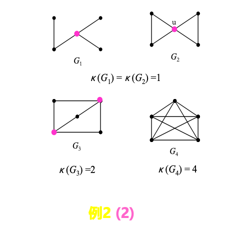
### **二、边割与边连通度**
#### **定义3（边割、边连通度）**
(1) 边集 E′ 使 G−E′ 不连通，则 E′ 为 **边割**，含 k 条边称 **k-边割**。  
(2) 最小边割的大小为 **边连通度 λ(G)**。
- 非连通图或平凡图：λ(G)=0。

#### **性质**
- e 是割边 ⇔ {e} 是 1-边割。
- 非平凡树 λ(G)=1。
## **三、边连通度与点连通度、最小度的关系**

#### **定理6（重要不等式）**

对任意图 G，都有：$κ(G)  ≤  λ(G)  ≤  δ(G)$
其中：
- κ(G) = 连通度（最小点割）
- λ(G) = 边连通度（最小边割）
- δ(G) = 最小度
#### **意义：**
- 一个图要被“点破坏”比“边破坏”更容易。
- 图的“最薄弱之处”由最小度决定。
### **定理6 证明主要逻辑（总结版）**

1. δ(G) 是任一顶点的度，因此其关联所有边构成一个边割 → λ(G) ≤ δ(G)
2. 用归纳法证明 κ(G) ≤ λ(G)：
    - 若 λ(G)=1，则图有割边 → κ(G)=1
    - 若 λ(G)=k≥2，用删除 k 条边使图断开，然后构造点割证明 κ(G) ≤ k
## **四、关于边连通度的上界（定理7）**
### **定理7**
设 G 是一个 n 阶、m 条边的连通图，则：
$κ(G) \le \frac{2m}{n}​$
由于：
$δ(G)\le \frac{2m}{n}​$
由定理6 结合 δ≥κ 得：
$κ(G)\le \left\lfloor \frac{2m}{n} \right\rfloor$
## 作业
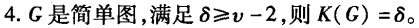

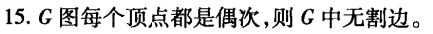
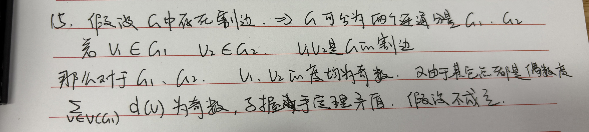

# 第四章
 Dijkstra和Floyd，学计算机的都会，略
 
 
 
 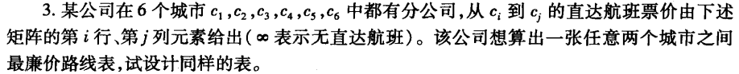
 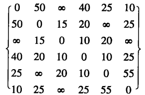
 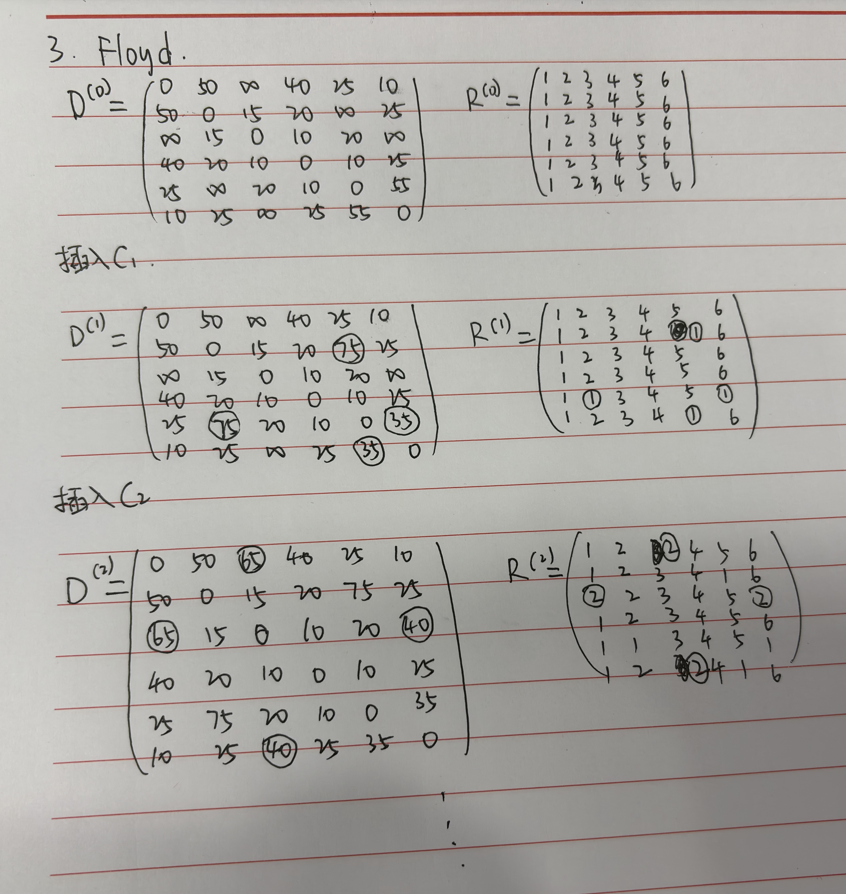
# 第五章

## 一、匹配与交错树（用于匈牙利算法）
### **定义1：M-交错树（Alternating Tree）**
设 **G = (X, Y)** 为二分图，M 为 G 中的匹配，u 为 M 的非饱和点。  
称树 **H** 为 **扎根于 u 的 M-交错树**，若满足：
1. $u \in V(H)$
2. 对任意 $v \in V(H)$，从 u 到 v 的路径是 **M-交错路**  
    （即边在 M 与不在 M 中交替出现）
### **定义：M-可扩路（Augmenting Path）**
在二分图中：
**一条从 M 非饱和点出发、到另一非饱和点结束、且是交错路径的路 P 称为 M-可扩路。**
利用可扩路 P，可以更新匹配：
$M' = M \Delta E(P)$
使匹配规模增大 1。  
（匈牙利算法的核心思想）
## 二、匈牙利算法（用于求完美匹配）
### **算法基于的关键理论（Hall 定理隐含）**
#### **推论（来自交错树分析）**
若在 M-交错树中：
$N(S) = T$
其中
- $S = V(H) \cap X$
- $T = V(H) \cap Y$
即 “邻接集与分层一致”
则由 **Hall 定理** 得：
$|N(S)| < |S| \quad\Rightarrow\quad G\text{ 无完美匹配}$
（匈牙利算法中用于判断“不存在完美匹配”）
## 三、最大匹配算法（匈牙利算法扩展）
匈牙利算法最初用于 **完美匹配**。  
通过继续在所有 M 非饱和点上构建交错树，可扩展为 **最大匹配算法**。
该部分 **没有新定义/定理**，只是算法步骤（略）。
## 四、最优匹配（Assignment Problem）相关定义与定理
用于求 **加权二分图** 的最大权完美匹配（匈牙利算法的加权版：Kuhn–Munkres / Hungarian algorithm）。
### **定义2：可行顶点标号（Feasible Labeling）**
设 $G = (X, Y)$ 为加权完全二分图，边权为 $w(x, y)$。  
若顶点标号函数：
$l : X \cup Y \to \mathbb{R}$
满足对于任意 $x \in X, y \in Y$：
$l(x) + l(y) \ge w(x,y)$
则称 **l 是一个可行顶点标号**。
#### **推论：可行标号总是存在**
任意加权完全二分图，都能构造可行标号，例如：
$l(x_i) = \max_{y_j} w(x_i, y_j), \quad l(y_j) = 0$
### **定义3：相等子图（Equality Graph）**
给定可行顶点标号 l，则定义：
$E_l = {(x,y) \mid l(x)+l(y)=w(x,y)}$
以 $E_l$ 为边集的生成子图：
$G_l = (X, Y; E_l)$
称为 **相等子图**（Equality graph）。
### **定理：相等子图中完美匹配 = 最优匹配**（核心定理）
#### **定理**
若可行标号 $l$ 的相等子图 $G_l$ 中存在完美匹配 $M^*$  
则 $M^*$ 是原图 G 的 **最优匹配**。
#### **证明要点总结**
对相等子图的完美匹配：
$w(M^*) = \sum_{(x,y)\in M^*} w(x,y)= \sum_{(x,y)\in M^*} (l(x)+l(y))$
任意其他完美匹配 M，由可行标号条件：
$w(x,y) \le l(x)+l(y)$
因此：
$w(M) \le w(M^*)$
从而：
$M^* \text{ 为最优匹配}$
==这是加权匈牙利算法正确性的核心。==
## 五、总结（定义 · 定理 · 推论总览）
### **定义**
1. **M-交错树**
2. **M-可扩路**
3. **可行顶点标号**
4. **相等子图**
### **定理**
1. **交错树中若 (N(S)=T) 则无完美匹配**（Hall 推论）
2. **相等子图有完美匹配 ⇒ 该匹配为最优匹配**（核心定理）
### **推论**
1. 任意加权完全二分图都存在可行顶点标号。
2. 相等子图寻找完美匹配即可求得最优匹配。
